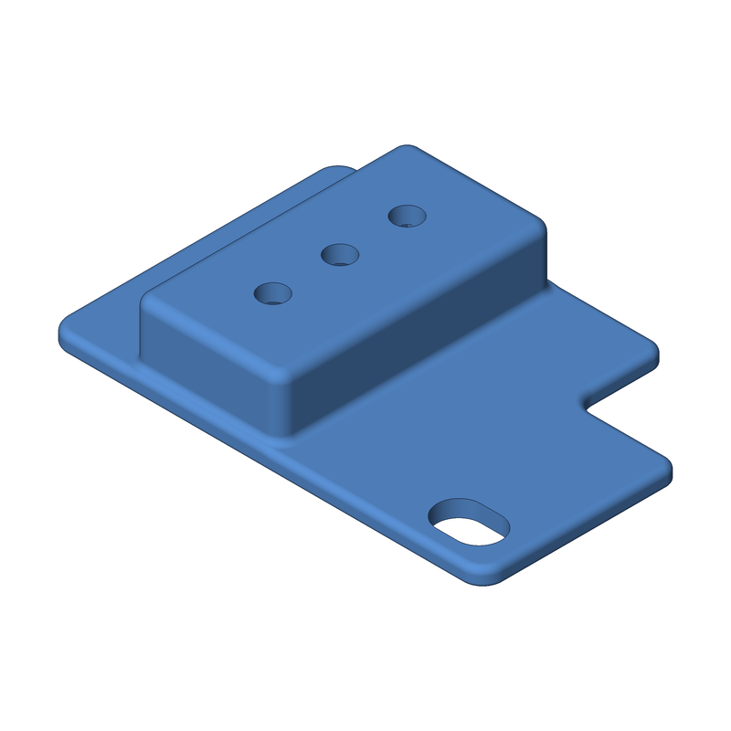
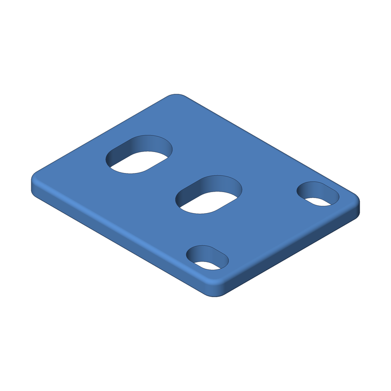

<div align="center">



# Server rack parts

**Parametric, 3D-printable parts for a 19" server rack, in Python.**

Each part is a [build123d](https://build123d.readthedocs.io) model. Run `make` to get STL, STEP and OBJ files plus an isometric PNG preview and a 1:1 SVG underside outline.


</div>

---

## Parts

| Part | Render | Description |
| --- | --- | --- |
| [`power_switch_cover`](models/power_switch_cover.py) |  | Cover for a rack PDU's power switch. A raised, hollow bubble guards the switch against accidental presses, with three light holes over it. It mounts on the lower 1U rack screw, and a corner cut-out clears the upper screw so the cover comes off without removing it. |
| [`cable_tie_plate`](models/cable_tie_plate.py) |  | Flat plate held by both 1U rack screws, with two 15 × 10 mm slots. Thread a cable tie or Velcro wrap through them to strap a vertical wire bundle to the rack. |

All parts share the same rack geometry (1U = 44.45 mm, 31.75 mm screw pitch, slotted M6 holes). The screw hole's distance from the rack ear's edge is an estimate, so measure your rack before printing.

## Usage

Requires [uv](https://docs.astral.sh/uv/) and make.

```sh
make setup                      # install deps into .venv (run once)
make                            # export both models (power_switch_cover, cable_tie_plate)
make MODEL=cable_tie_plate      # export models/cable_tie_plate.py into build/cable-tie-plate/
make png MODEL=cable_tie_plate  # export only if build/cable-tie-plate/cable-tie-plate.png is stale
make view MODEL=cable_tie_plate # export and show in the OCP viewer (needs it running)
make list                       # list available models
make clean                      # delete build/
make help                       # show all targets
```

Each model exports into its own folder, `build/<slug>/`, where `<slug>` is the model name with underscores replaced by hyphens. One exporter run writes all five files, so `stl`, `step`, `obj`, `png` and `svg` each rebuild everything when the model is out of date.

Add a part by copying `models/example.py`; each model defines `build()`. To refresh the renders above, run `make MODEL=<name>` and copy `build/<slug>/<slug>.png` into `docs/`.
See `CLAUDE.md` for conventions (written for AI agents, useful for humans too).

---

<p align="center">Built with ❤️ by <a href="https://x.com/aeksco">aeksco</a></p>
